 

  

  

 

I build backend services and LLM-powered automation: the unglamorous plumbing that makes AI features reliable, fast, and useful. I like clean APIs, honest evals, and systems that fail gracefully.

---

## 🛰️ Mission Status

| | |
|:---|:---|
| 🟣 **In orbit** | Building LLM / GenAI projects: agents, RAG, automation |
| 🔵 **Exploring** | LLM evaluation, orchestration, and production patterns |
| 🟣 **Training** | LeetCode, to keep the algorithm engines warm |
| 🔵 **Open to** | Collaborations, open source, and big engineering challenges |

---

## 🪐 The Solar System of Skills

| Planet | Domain | Tools |
|:---|:---|:---|
| ☀️ **The Sun** · core | Language |  |
| ☿️ **Mercury** · ML & signals | Models |    |
| 🪐 **Saturn** · GenAI / LLM | AI systems |      |
| 🌍 **Earth** · backend | Services |    |
| 🔵 **Neptune** · data | Storage |   |
| 🔴 **Mars** · DevOps | Delivery |     |
| 🌙 **The Moon** · frontend | Interfaces |     |

---

## 🚀 Featured Missions

<table>
<tr>
<td valign="top">

### ⚙️ Main Mission: BearingGuard
**AI-powered bearing fault detection from vibration signals**
*Turning raw industrial vibration data into real-time fault predictions, end to end.*

📄 **Vibration data** → 📊 **Features** → 🌲 **Random Forest** → ⚡ **FastAPI** → ⚛️ **React result**

A full-stack ML application that takes a MATLAB `.mat` vibration recording plus motor RPM and returns a fault prediction, confidence scores, and a plain-language recommendation. It goes beyond a notebook: a deployable, tested system from raw signal to web UI.

**Flight systems**
- 🩺 Classifies four conditions: normal, inner-race, outer-race and ball faults
- 📡 Signal processing on 2,048-sample windows at 12 kHz, with time-domain, FFT and Hilbert-envelope features tied to bearing fault frequencies (BPFI, BPFO, BSF, FTF)
- 🌲 Random Forest model persisted with Joblib and served through a FastAPI inference API
- ⚛️ React (Vite) frontend for upload, validation and results
- 🧪 Verified with 8 end-to-end test cases, covering all four conditions, bad input and frontend ↔ backend integration

   

</td>
</tr>
</table>

<table>
<tr>
<td valign="top">

### 🌙 Mission 02: Luma
A web app built with **Next.js** and **TypeScript**, using **shadcn/ui** components.
<!-- TODO: add one line about what Luma does and who it is for -->

  

</td>
</tr>
</table>

---

## 📡 Telemetry

  

---

## 🔭 Flight Principles

| | |
|:---|:---|
| 🚀 **Launch it, then make it better.** | 📜 **Read the logs. The answer is almost always there.** |
| 🧠 **LLMs are powerful, but only with solid engineering around them.** | 🤝 **Be the engineer you wished you'd had as a mentor.** |

 

